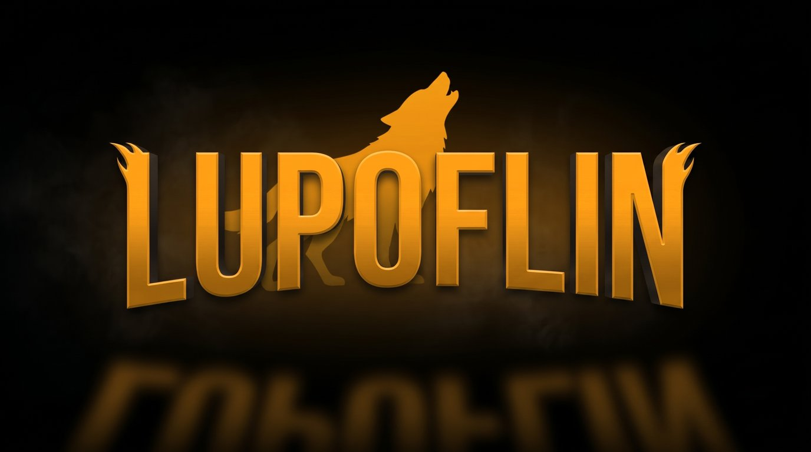

<p align="center"></p>

# LupoFlin

**An experimental Jellyfin client for LG webOS TVs, with a Netflix-style interface.**

> **Alpha. Built almost entirely by AI agents. Take it with a grain of salt.**
> This is an experiment in building a real app with cheap AI models, not a finished product.
> It works on my LG TV with my Jellyfin server; it may not work on yours. Not affiliated with Netflix or Jellyfin.

## How this was built (read this first)

I am not a front-end developer and I don't know LightningJS. The code was written by AI agents, in small
steps, with automatic checks after each one:

- **Writer:** Gemini Flash in Antigravity, working one small step at a time from task files (`docs/tasks/`).
- **Reviewer:** Claude, checking each stage against a checklist (`docs/JUDGE.md`) and re-running the checks.
- **Me:** deciding what to build, testing on a real LG TV, and saying no.

The method is in the repository, on purpose: `AGENTS.md` (rules for the agents), `docs/PLAN.md` (stages and a
progress log with the real result of every check), `docs/AUTOPILOT.md` (how the writer works through tasks),
`docs/reviews/` (review reports). The project was developed under the working name *Lupoflix*, which you
will still find in those documents. The development history was not published: the progress log in
`docs/PLAN.md` records every step and its checks instead.

So: expect rough edges, odd code in places, and an Italian-only UI for now.

## Why a new client

I wanted a faster Jellyfin client that feels like the streaming apps my family already uses: rows of posters, a big
billboard, profiles, fast navigation with the remote. I also wanted to see how far cheap AI models can go on a
real project if the work is cut into small, checkable steps.

If you want a mature client, look at the official Jellyfin webOS app (very slow on my TV) or
[Litefin](https://github.com/MoazSalem/litefin) (multi-platform, much more complete, I need to try it though).

## What works

- Server address entry with an on-screen keyboard, Quick Connect, password-less profiles ("who's watching?")
- Home with billboard and rows (continue watching, next up, latest, libraries), library grids, search and filters
- Details pages for movies and series, seasons and episodes
- Playback with the TV's native player: resume, progress reporting, subtitles, next-episode card
- I have used the GetAvatar plugin and it works like a charm
- Jellyfin users must be with empty passwords

## Install on an LG TV (Developer Mode)

1. Enable **Developer Mode** on the TV (LG Developer Mode app, free LG developer account).
2. Download the `.ipk` from [Releases](../../releases).
3. Install it with the webOS CLI: `ares-install -d <your-tv> lupoflin-<version>.ipk`
   (or `npm run tv install <ipk>` from this repository).
4. Start LupoFlin and enter your Jellyfin server address.

Developer Mode sessions expire and must be renewed from the Developer Mode app.
The Homebrew Channel should also work, but I have never tried it.

## Build from source

```bash
npm install
cp config.example.json static/config.local.json   # server address for development; git-ignored
npm run check                                      # unit tests, real-server API checks, UI in headless Chromium
npm run package                                    # builds the .ipk in .tmp/ipk/
```

The public package contains no server address: every user enters their own on first start.

## Architecture

- **LightningJS on WebGL, no HTML UI.** Every pixel is drawn by Lightning; the DOM is not used for the
  interface. Why: I asked Claude, and it told me that the native TV apps of Netflix and YouTube follow a similar
  idea (their own rendering instead of a heavy HTML page: Netflix Gibbon, YouTube Cobalt). I don't know
  Lightning or other UI frameworks, so this was a choice made on AI advice, not on my own experience.
- **Jellyfin is only a REST API.** All endpoints live in `src/lib/jellyfin.js`; nothing else talks to the server.
- **One screen per file** (`src/views/`), reusable components in `src/components/`, pure logic with unit tests
  in `src/lib/`, colours and sizes only in `src/theme.js`.
- **webOS only, for now.** The core is a web app, so other TV platforms are possible, but untested.

## How it is verified

Every step must pass its checks in the same session before it is committed:

| Level | What | Command |
|---|---|---|
| L0 | unit tests on the pure logic | `npm test` |
| L1 API | smoke test against a real Jellyfin server | `npm run check:api` |
| L1 UI | the app in headless Chromium, driven by key presses, read through a test probe | `npm run check:ui` |
| Regression | every finished scenario again | `npm run check:regress` |
| L3 | the real TV, by hand | `npm run tv ...` |

## Known limits

- UI in Italian only.
- Tested on one TV only: LG 55QNED85T6C (2024, webOS SDK 10.3.2), with one Jellyfin server.
- Image-based subtitles (PGS, DVD), common in MKV rips of Blu-rays and DVDs, are not supported yet: only text
  subtitles are shown.
- Alpha: bugs are expected. Issues are welcome; answers may be slow.

## License

MIT, see [LICENSE](LICENSE). The LupoFlin name and logo were made for this project with an AI image tool.
